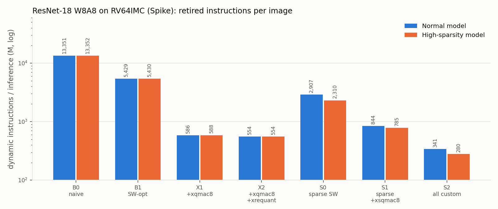
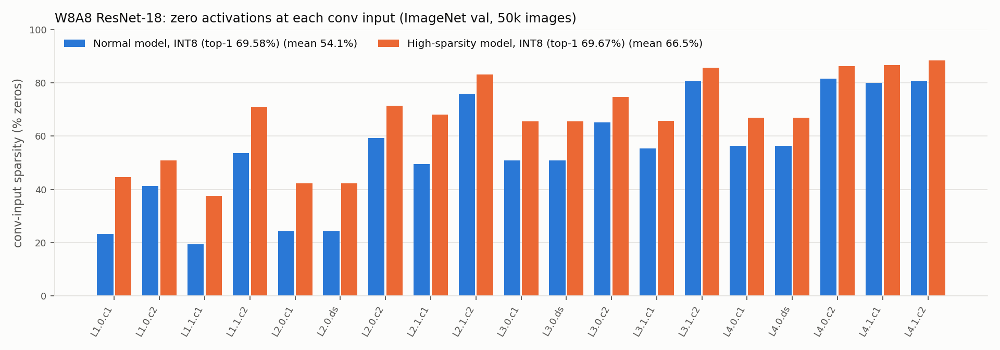

# Activation-Sparse, W8A8 ResNet-18 on RV64IMC with Custom ISA Extensions (Spike)

Midterm project: ISA-level evaluation of custom RISC-V instructions for
quantized CNN inference.

The key point of our ISA based optimizations here is to realize that many convolutional neural networks use ReLU as an activation function. As a result of this, they have a large amount
of 0s in the activations. These are actually operations which could be skipped, if the underlying architecture could take advantage of it. So, in this project, we present two ISA optimizations,
first is the xqmac8 which is a packed INT8 multiply-accumulate instruction. In addition to this, we introduce xsqmac8 which is a sparse MAC command, which can take advantage of 0s in the 
model's activations to skip calculations.

Then, to we use hardware-software codesign, to increase the gain we get from using xsqmac8 even further by taking inspiration from a paper called "Inducing and Exploiting Activation Sparsity
for Fast Inference on Deep Neural Networks" by Kurtz et al, PMLR 2020. They show you can use something called Hoyer loss to increase the sparsity of a model without affecting the accuracy. So we fine
tune our model with hoyer loss to increase sparsity, and show that the higher sparsity model paired with xsqmac8 can obtain an even better performance. Our results are presented below.

* **Workload:** ResNet-18 (ImageNet, 1.81 GMAC) from Hugging Face
  (`timm/resnet18.tv_in1k`), quantized to **INT8 weights / 8-bit activations**,
  running bare-metal on **RV64IMC** in **Spike**.
* **Two models:**
  * the **normal** model (pretrained);
  * a **high-activation-sparsity** model, fine-tuned with **square-Hoyer
    regularization + FATReLU** following Kurtz et al., *Inducing and Exploiting
    Activation Sparsity for Fast Neural Network Inference*, ICML 2020. It has
    **no accuracy loss** in either FP32 or INT8.
* **Custom extension `Xqnn`** (custom-0 opcode, implemented in Spike):

| Instruction | What it does |
|---|---|
| `xqmac8` / `xqmac8u` | 8 × INT8 multiply-accumulate (dot product) into a 64-bit GPR (signed / unsigned activations) |
| `xrequant` | multiply → round → shift → zero point → saturate, plus a fused (FAT)ReLU threshold |
| `xsqmac8` | **sparse outer-product MAC**: one nonzero activation × 8 weights → 8 internal 32-bit accumulators (scalar version of the paper's `vbroadcast+vfmadd` sparse convolution) |
| `xsaccrd` / `xsaccclr` | read-and-clear one accumulator / clear all |

See **[DESIGN.md](DESIGN.md)** for the instruction semantics, encodings,
rationale and kernels, and **[EXPERIMENTS.md](EXPERIMENTS.md)** for all
measurements and the bottleneck analysis.

## Headline results

**Accuracy** (ImageNet val, 50k images) and **activation sparsity** (zeros at the inputs of the 19 sparse-able convs):

| Model | FP32 top-1 | W8A8 top-1 | sparsity FP32 | sparsity INT8 |
|---|---:|---:|---:|---:|
| Normal (pretrained `timm/resnet18.tv_in1k`) | 69.76% | **69.58%** | 53.4% | 54.1% |
| High-sparsity (Hoyer + FATReLU, QAT) | 69.55%¹ | **69.67%** | 67.6% | 66.5% |

¹ The QAT-trained weights evaluated in float; the deployed INT8 model beats the
INT8 baseline. See EXPERIMENTS.md §1.3.

**Retired instructions per inference on Spike** (RV64IMC, mean of 8 images,
every run bit-exact with the Python integer reference):

| Config | Custom instructions | Normal model | High-sparsity model | vs B0 | vs X2 |
|---|---|---:|---:|---:|---:|
| B0 naive | — | 13,351 M | 13,352 M | 1× | |
| B1 SW-optimized | — | 5,429 M | 5,430 M | 2.5× | |
| X1 | `xqmac8` | 586 M | 588 M | 22.7× | |
| X2 | `xqmac8` + `xrequant` | 554 M | 554 M | 24.1× | 1× |
| S0 sparse SW | — | 2,907 M | 2,310 M | 5.8× | |
| S1 sparse | `xsqmac8` | 844 M | 785 M | 17.0× | |
| **S2 all** | `xsqmac8` + `xqmac8` + `xrequant` | **341 M** | **280 M** | **47.7×** | **1.98×** |

(The "vs" columns are for the high-sparsity model.)

* MAC/instruction goes from 0.14 (B0) to 3.3 (X2) to **6.5** (S2,
  high-sparsity, dense-equivalent).
* On the high-sparsity model the sparse instruction gives **1.98×** over the
  dense packed-MAC ISA, and Kurtz-style sparsification gives a further 1.22×
  over the normal model on the same ISA.




## Repository layout

```
README.md  DESIGN.md  EXPERIMENTS.md  AI_USAGE.md  Makefile  requirements.txt
python/            model download, Hoyer/FATReLU fine-tuning, sensitivity analysis,
                   sparsity measurement + plots, W8A8 quantization + bit-exact integer
                   reference (quantize.py), C export (export_c.py)
src/spike_ext/     xqnn.cc — Spike implementation of the custom instructions
src/runtime/       bare-metal start-up, linker script, HTIF console, printf
src/nn/            kernels.c (all kernel variants), model.c (ResNet-18 graph), main.c,
                   xqnn.h (inline-asm wrappers + C emulation), nn.h
src/tests/         test_xqnn.c (instruction tests), test_kernels.c (kernel tests)
scripts/           setup_toolchain.sh, build_spike.sh, train_sparse.sh, run_tests.sh,
                   check_native.sh, run_benchmarks.py, make_figures.py, make_isa_diagram.py,
                   reproduce_all.sh
docs/              xqmac8_xsqmac8.pdf — one-page diagram of the two MAC instructions
third_party/       riscv-isa-sim (Spike) — git submodule, pinned commit
results/           accuracy/, sparsity/, sensitivity/, raw/ (Spike logs), *.csv,
                   figures/, summary.md
```

## Setup

Requirements: Linux x86-64 (tested on Ubuntu 22.04), gcc/g++, make,
device-tree-compiler (`dtc`), Python ≥ 3.10 with PyTorch (CUDA GPU for
training/eval), and ImageNet-1k in ImageFolder layout (`train/`, `val/`).

```bash
git submodule update --init                 # Spike source
make setup                                  # prebuilt riscv64-elf GCC -> tools/riscv,
                                            # Spike + Xqnn -> tools/spike
python -m venv --system-site-packages .venv && .venv/bin/pip install -r requirements.txt
export IMAGENET_ROOT=/path/to/imagenet      # default: ~/imagenet_local
```

No sudo is needed. If `dtc` is not on `PATH`, set `DTC_DIR`.

## 1. Models: download, sparsify, quantize, export

```bash
scripts/train_sparse.sh        # 3 GPUs, ~2.5 h: Hoyer FT -> FATReLU sensitivity -> recovery FT
                               # (thresholds fixed, QAT + self-distillation)
                               # -> FP32 val accuracy + per-layer sparsity
for m in dense:models/resnet18_tv_in1k.safetensors sparse:models/sparse/model.pt; do
  n=${m%%:*}; c=${m#*:}
  sc=""; [ -f models/$n/qat_scales.json ] && sc="--scales models/$n/qat_scales.json"
  .venv/bin/python python/quantize.py $c $sc --out models/$n/qmodel.pt \
        --json results/accuracy/int8_${n}_val.json          # W8A8 + INT8 val accuracy
  .venv/bin/python python/export_c.py models/$n/qmodel.pt --out models/$n/export --nimg 16
done
.venv/bin/python python/plot_sparsity.py                    # results/figures/sparsity_*.png
```

`export_c.py` writes:
* the weight/parameter blob in every layout the kernels use;
* the C descriptor tables;
* 16 ImageNet val images, pre-quantized;
* their golden logits from the bit-exact Python integer model.

The ELF embeds all of these with `.incbin`.

## 2. Verification tests

```bash
make test                      # = scripts/run_tests.sh
```

1. **Instruction tests** (`src/tests/test_xqnn.c`): about 105k directed and
   random checks of all 6 instructions against an independent C reference. They
   run on Spike and natively.
2. **Kernel tests** (`src/tests/test_kernels.c`): every kernel configuration
   (B0…S2, and NGRP = 2/4/8/16) against a reference convolution. The cases cover
   random shapes, strides 1/2, 1×1/3×3 kernels, densities 0–100%, int8/uint8
   requantization and FATReLU thresholds.
3. **Full-model golden check:** each configuration on Spike must reproduce all
   1000 int32 logits of the Python reference.

`scripts/check_native.sh` repeats the bit-exactness check for 1000 val images
using a host build of the same C sources, with the custom instructions emulated
in C.

Expected output ends with `ALL TESTS PASSED`.

## 3. Running the workload on Spike

```bash
make run MODEL=sparse CFG=S2 NIMG=1
# IMG 0 instret 282442923 pred 838 label 720 golden OK
# OP <operator> <instret> ...     (per-operator retired instructions)
# RESULT PASS images 1 total_instret ...
```

| `CFG` | Kernels | Custom instructions used |
|---|---|---|
| `B0` | naive dense direct conv | — |
| `B1` | software-optimized dense (2px×4oc register blocking) | — |
| `X1` | blocked dense (4px×4oc) | `xqmac8(u)` |
| `X2` | X1 + hardware requantization | `xqmac8(u)`, `xrequant` |
| `S0` | sparse-input conv (runtime CSR, paper Alg. 1), scalar | — |
| `S1` | sparse-input conv with accumulator file | `xsqmac8`, `xsaccrd` |
| `S2` | **all**: sparse convs + dense stem/FC with xqmac8 + requant | all |

Other knobs:
* `MODEL=dense|sparse` selects the model.
* `NIMG` sets the number of images.
* `NGRP=2|4|8|16` sets the accumulator groups (8 accumulators each). Set
  `XQNN_NGRP` for Spike to match; the scripts do this.
* `DISPATCH=<permille>` makes layers with input density above the threshold use
  the dense xqmac8 kernel.

## 4. Reproducible benchmarks

```bash
scripts/run_benchmarks.py --nimg 8 --mix --sweep   # all models x configs on Spike (parallel)
scripts/make_figures.py                            # figures + results/summary.md
# or everything end-to-end:
scripts/reproduce_all.sh
```

Results:
* `results/benchmarks.csv`: instructions per image (mean/std over 8 images),
  golden PASS, `.text` size, MAC/instruction.
* `results/ops.csv`: per-operator instructions.
* `results/mix.csv`: load/store/ALU/mul/branch/custom mix from Spike's `-g` PC
  histogram plus objdump.
* `results/sparsity_runtime.csv`: per-layer density seen at runtime.
* `results/figures/*.png`
* `results/summary.md`: all tables.

The instruction counts are deterministic for a given image. The 8 benchmark
images are the first 8 of the embedded 16. The full matrix (50 Spike runs,
including the sweeps and histogram runs) takes about 25 minutes on 32 cores.
B0 alone runs at about 190 MIPS, roughly 70 s per image.
